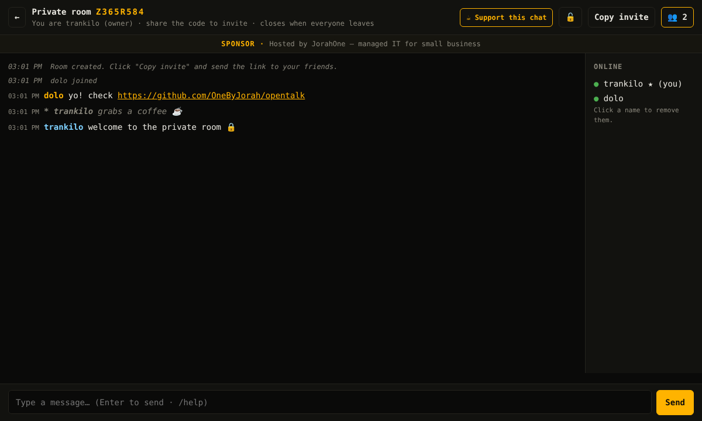
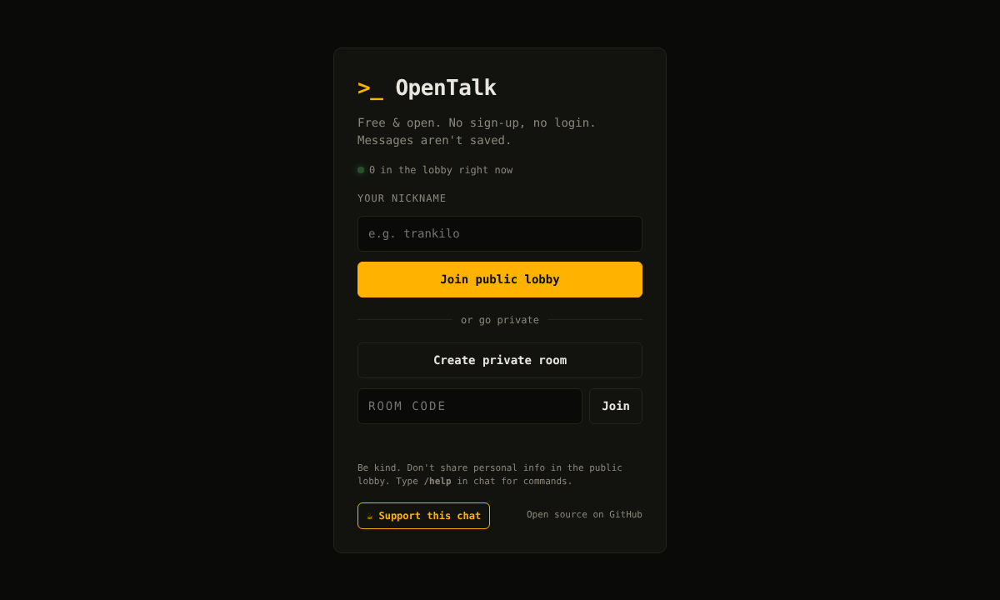
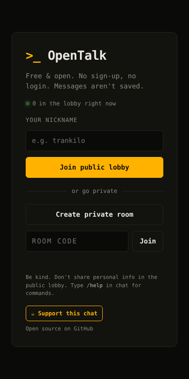

<div align="center">

# `>_` OpenTalk

**Free, open chat for your website. No sign-up, no login, no database.**
A public lobby anyone can drop into, plus private rooms you join with a code.

[](https://github.com/OneByJorah/opentalk/actions/workflows/ci.yml)
[](https://github.com/OneByJorah/opentalk/pkgs/container/opentalk)
[](LICENSE)




</div>

## Features

- **No accounts:** visitors pick a nickname and start talking. Nothing to sign up for and no passwords to leak.
- **Public lobby:** an open room for everyone, with a live "people online" counter on the landing page.
- **Private rooms:** one click creates a room with an 8-character code (e.g. `K7QM2XPA`). Share the code or the invite link, and you can lock the room once everyone has arrived.
- **Ephemeral:** messages live only in memory. A private room is wiped the moment the last person leaves, and nothing is written to disk.
- **Moderation built in:** room owners can kick and lock. Site admins can ban, clear and make site-wide announcements. Also includes a word filter, link blocking in the lobby, and `/report`.
- **Optional money features:** a donate button, a self-hosted sponsor banner, and Google AdSense slots. All are off until you set them (see [MONETIZATION.md](MONETIZATION.md)).
- **Small and fast:** one Node.js process with one dependency (`ws`) and a plain-JS frontend with no build step.
- **Hardened by default:** strict CSP, origin checks, per-IP limits, brute-force lockout, and a read-only, non-root container. See [Security](#security).

<p align="center">
  
  
</p>

## Quick start

**Docker (recommended)**

```bash
git clone https://github.com/OneByJorah/opentalk && cd opentalk
cp .env.example .env          # edit ALLOWED_ORIGINS, ADMIN_KEY, etc.
docker compose up -d --build
# → http://127.0.0.1:8080
```

**Node.js 20+**

```bash
npm install
npm start          # PORT=8080 by default
npm test           # end-to-end tests
```

## Putting it on the internet

The container only listens on `127.0.0.1`. Publish it through one of these:

- **Cloudflare Tunnel** (no open ports): uncomment the `cloudflared` service in `docker-compose.yml`, create a tunnel, and point your hostname at `http://opentalk:8080`.
- **Caddy**: `chat.example.com { reverse_proxy 127.0.0.1:8080 }` (WebSockets work automatically).
- **nginx**: proxy to `127.0.0.1:8080` and pass the `Upgrade` and `Connection` headers for `/ws`.

Then set `ALLOWED_ORIGINS=https://chat.example.com` and `TRUST_PROXY=1` in `.env`.

## Chat commands

| Command | Who | What it does |
|---|---|---|
| `/help` | everyone | List commands |
| `/me waves` | everyone | Action message |
| `/nick newname` | everyone | Change nickname |
| `/report name` | everyone | Report someone (logged for the admin) |
| `/kick name` | room owner, admin | Remove someone and block them from rejoining that room |
| `/lock` · `/unlock` | room owner, admin | Stop or allow new people joining a private room |
| `/clear` | room owner, admin | Clear the room's history |
| `/admin <key>` | anyone with `ADMIN_KEY` | Become a site admin for this session |
| `/ban name` | admin | Ban that IP for `BAN_HOURS` |
| `/announce text` | admin | Banner message to every room |

The person who creates a private room is its owner (★). If they leave, ownership passes to the next person. Owners can also click a name in the user list to kick that person.

Reports and bans are printed as JSON lines in the container logs (`docker logs opentalk | grep report`). Raw IPs are never logged, only a salted hash that changes on every restart.

## Configuration

Everything is set through environment variables. See [`.env.example`](.env.example) for the full list with comments. The main ones:

| Variable | Default | |
|---|---|---|
| `ALLOWED_ORIGINS` | *(any)* | Comma-separated public URLs allowed to connect |
| `TRUST_PROXY` | `0` | Use `CF-Connecting-IP` / `X-Forwarded-For` for real IPs |
| `ADMIN_KEY` | *(off)* | Enables `/admin`. Use `openssl rand -hex 24` |
| `LOBBY_LINKS` | `0` | Allow URLs in the public lobby |
| `ENABLE_LOBBY` | `1` | Set `0` for private-rooms-only |
| `BLOCKED_WORDS` | | Extra filtered words (also reads `blocked-words.txt`) |
| `SITE_NAME` | `OpenTalk` | Your brand name |
| `DONATE_URL` / `SPONSOR_TEXT` / `ADSENSE_CLIENT` | *(off)* | Money features, see [MONETIZATION.md](MONETIZATION.md) |

## Security

| Threat | Protection |
|---|---|
| XSS / script injection | Every message is rendered with `textContent`, never HTML. Links are built as DOM nodes (http/https only, `rel="nofollow ugc noopener"`). Strict CSP with no inline scripts (per-request nonce when ads are on). |
| Guessing room codes | 32⁸ ≈ 1.1 trillion codes from a crypto RNG. 10 wrong codes per IP per minute, then lockout. |
| Spam / flooding | 5-message burst, then 1 msg/s. Auto-disconnect for repeat abuse. 500-char messages, 2 KB frames. Links blocked in the lobby. |
| Connection floods | Per-IP socket cap, per-room caps, global room cap. |
| Cross-site socket hijacking | WebSocket `Origin` allowlist. |
| Clickjacking / sniffing | `frame-ancestors 'none'`, `X-Frame-Options`, `nosniff`, HSTS. |
| Impersonation | Nicknames like `admin`, `mod` and `system` are reserved. Admin and owner badges are set by the server. |
| Room codes leaking into logs | Invite links use the URL `#fragment`, which browsers never send to servers. |
| Privacy | No database, no cookies, no analytics. Only the nickname is kept, in the visitor's own browser. |
| Container | Non-root, read-only filesystem, all capabilities dropped, memory and PID limits. |

**About "private":** private rooms are unlisted and code-protected, and all traffic is encrypted with TLS. They are **not** end-to-end encrypted, so the server relays (but never stores) the messages.

Found a vulnerability? See [SECURITY.md](SECURITY.md).

## Scaling

A single process comfortably handles hundreds to a few thousand concurrent users. Past that, put several instances behind a load balancer with sticky sessions and add Redis pub/sub for cross-instance rooms. PRs welcome.

## Roadmap

- [ ] Optional end-to-end encryption for private rooms (key in the invite-link fragment)
- [ ] Embeddable widget (`<script src=…>` bubble for any website)
- [ ] Image sharing (opt-in, size-limited)
- [ ] Redis adapter for multi-instance deployments
- [ ] Translations (ES, Papiamentu, NL)

## Contributing

Issues and PRs welcome. See [CONTRIBUTING.md](CONTRIBUTING.md).

## License

[MIT](LICENSE) © Jhonattan / [OneByJorah](https://github.com/OneByJorah)
